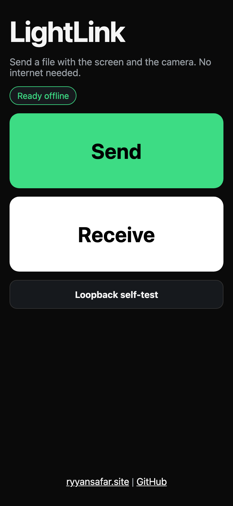
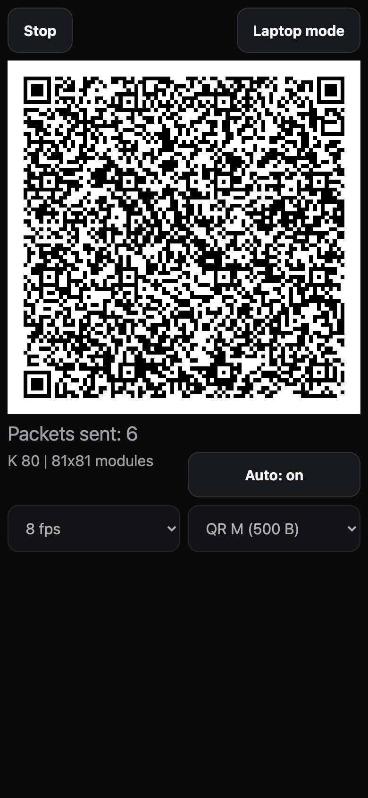
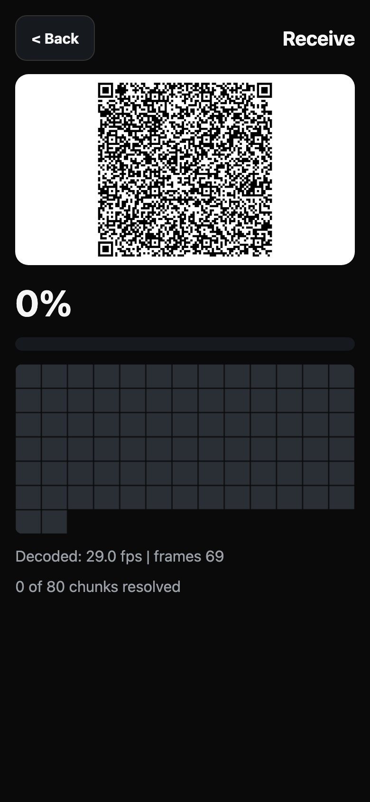
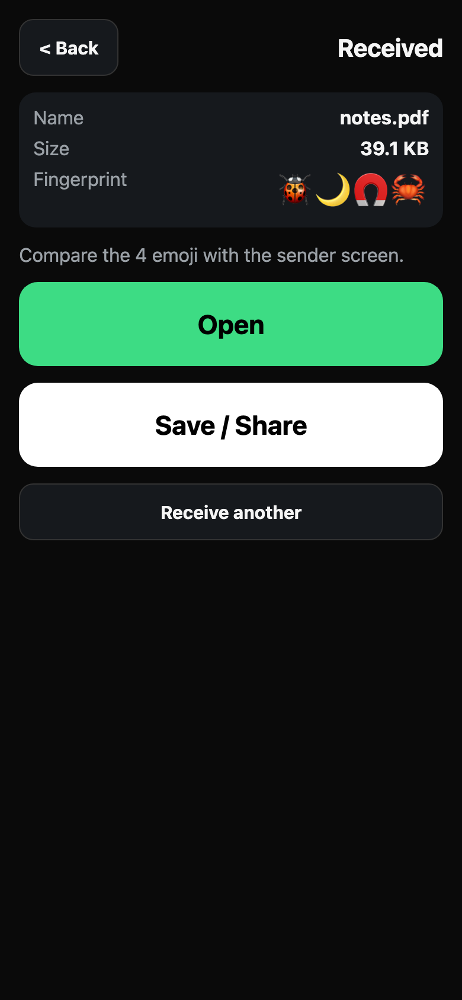

# LightLink

Send a file between two phones using only the screen and the camera. The sender plays an animated stream of QR codes (a fountain code). The receiver points its camera at it. No internet, no Bluetooth, no cables. Works in airplane mode once the app has been opened once and cached.

Status: hackathon build (v0.1.0). Codec in `src/codec/`, PWA in `src/ui/`, end-to-end tests in `e2e/`.

Live: https://lightlink-liart.vercel.app (the camera needs HTTPS; the build in `dist/` is a plain static site and works from any HTTPS host).

| Home | Sender | Receiver | Done |
|---|---|---|---|
|  |  |  |  |

More captures (desktop, camera denied, no camera, low decode rate, loopback) are in `docs/screenshots/`.

## How it works, in plain words

1. The sender cuts the file into equal chunks (500 bytes by default, the QR M size; QR S is 250 and QR L is 900).
2. It then makes an endless stream of packets. Each packet is the XOR of a few randomly chosen chunks, plus a small header (transfer id, chunk count, packet seed, CRC-32). That is a fountain code (an LT code).
3. Each packet is drawn as one QR code (byte mode, error correction L) and the codes are shown as a video.
4. The receiver reads QR codes from the camera (jsQR in a Web Worker). It does not matter which packets it misses. Once it has seen slightly more packets than there are chunks (measured average about 1.06x at K around 100), it can solve for every chunk: first by peeling, then by Gaussian elimination over GF(2) for the stubborn last part.
5. A 4 emoji fingerprint of the SHA-256 of the file is shown on both phones. If they match, the bytes match.

Because any packet is as good as any other, covering the screen for a few seconds, bad focus or a late start only delay the transfer. Nothing needs to be re-sent. If the sender restarts or changes the QR size, the receiver follows the new transfer after a few valid packets.

## Measured numbers

All measured on one MacBook, headless Chromium, driven by Playwright, in October 2026. Rows marked "single run" are one run each and vary from run to run, so read them as order of magnitude, not benchmarks. The "camera" is a canvas capture stream of the sender page, so these are decode-limited upper bounds, not real camera throughput. Real phone-to-phone has now been run once (see the Android row below); its throughput was not measured precisely.

| Test | Result |
|---|---|
| Codec unit tests | 22 pass. Overhead about 1.06x at K=100 (the test asserts under 1.25 over 200 seeds) |
| 20 KB random file, 20 fps | single run: 4.2 s, bytes and fingerprint equal |
| 30 KB, QR size S (250 B chunks), 15 fps | single run: 10.5 s, equal |
| 30 KB, QR size L (900 B chunks), 15 fps | 5.0 s in one run, 91.8 s in a later run on the same MacBook (cause not isolated; other jobs were running on the machine), equal |
| 60 KB with the sender covered for 3 s mid-transfer | completes, equal |
| PDF, PNG, vCard | complete, byte for byte equal, fingerprint equal |
| 1 MB random file, QR L, 30 fps | single run: 70.9 s (about 14.4 KB/s), equal |
| Loopback self-test, 100 KB | PASS, 8 to 9 s across runs (about 11 to 12 KB/s), headless Chromium on a Mac, synthetic canvas camera, Oct 2026 |
| **Real phone-to-phone, two Android phones, Chrome, 25 Oct 2026** | An 86.0 KB PDF ("The Class of 2025 - Agenda.pdf") was received and the fingerprint appeared. The sender used laptop mode (large QR). Screenshots timestamped 06:47 (sender) and 06:49 (received), so it finished in about two minutes; exact seconds and device models were not recorded. Early on the receiver showed 0.5 decoded fps and its low-rate hint before it locked on. One run, not a benchmark. |
| Offline after first load | home screen and loopback work with the network switched off |

## Run it

```
npm install
npm run dev            # vite dev server (the camera needs HTTPS or localhost)
npm test               # vitest, codec
npm run build          # typecheck + production build
npx playwright install chromium
npm run test:e2e       # run `npm run build` first; serves dist with vite preview
npm run bench          # codec overhead benchmark
npm run screenshots    # regenerate docs/screenshots (needs `npx vite preview --port 4173` running)
```

CI (`.github/workflows/ci.yml`) runs typecheck, unit tests, build and the e2e suite (the 1 MB test is skipped in CI).

Docs: [3-minute demo script](docs/DEMO.md), [how to explain it and judge Q&A](docs/EXPLAIN.md).

## Limits

- Throughput is a few KB/s to low tens of KB/s. It is for small files: contacts, PDFs, photos, notes. A 1 MB file took about 71 s in the synthetic test and will likely take longer with real cameras.
- Both screens need decent brightness, a steady hold and no heavy glare. A low decode rate shows a hint on the receiver.
- Not yet tested on real iOS Safari or Android Chrome cameras in this repo. The camera API needs HTTPS (or localhost).
- Chunk count is a 16-bit field (65,535 max), far beyond what is practical.
- No encryption or authentication. The fingerprint catches corruption and mix-ups. Anyone who can film the screen can get the file.
- The sender must stay in the app and awake (a screen wake lock is requested where supported).

## Links

- Portfolio: https://ryyansafar.site
- GitHub: https://github.com/ryyansafar
- Buy me a coffee: https://buymeacoffee.com/ryyansafar
- PayPal: https://www.paypal.com/paypalme/ryyansafar
- Razorpay: https://razorpay.me/@ryyansafar

## Real-camera status

No transfer has yet been run through a physical phone camera; every number above is from a synthetic canvas camera in headless Chromium. The 1 MB / 14.4 KB/s figure uses QR L at 30 fps and is laptop-to-laptop only. For phones use the defaults (QR M, 8 fps); if the receiver shows the low decode rate hint, ask the sender for QR S and a lower fps. The receiver reads the camera at 800 px wide and switches to 1280 px for dense QR codes or when decoding is slow.

## Prior art

Streaming a file as animated QR codes is not new, and neither are fountain codes. Existing projects include txqr, qrstream, Decimen Optical (animated QR with fountain coding) and Cimbar (a colour-barcode project that reaches much higher throughput). LightLink does not claim the technique.

What is different here is packaging and verification:

- Zero install: a web page that works offline on any phone after one visit.
- A 4-emoji fingerprint of the file's SHA-256, shown on both screens.
- A loopback self-test that pushes a file through the real draw and decode path on one device.
- A browser test suite (Playwright) that exercises the real QR draw and decode path, not only the codec.
- Peeling followed by a GF(2) elimination fallback (measured overhead is in the table above).

## AI usage and Devin

Built by one developer directing AI coding agents; blind model judges chose the idea and reviewed the result. Devin was **not** used on this repository (its cloud account returned a billing `out_of_quota` error), so no commit here is Devin work. Full, honest account: [docs/AI_USAGE.md](docs/AI_USAGE.md).
